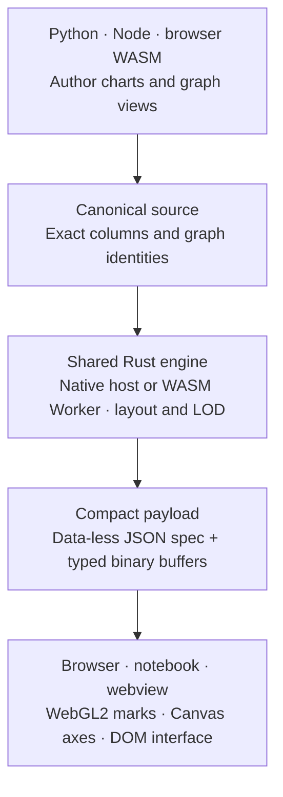

<p align="center">
  
</p>

<p align="center">
  <a href="https://github.com/CurateLabs/xyg/actions/workflows/ci.yml"></a>
  <a href="https://app.codspeed.io/CurateLabs/xyg?utm_source=badge"></a>
  <a href="pyproject.toml"></a>
  <a href="https://github.com/CurateLabs/xyg/tree/main/docs" target="_blank" rel="noopener noreferrer"></a>
  <a href="https://mybinder.org/v2/gh/CurateLabs/xyg/main?urlpath=lab/tree/examples" target="_blank" rel="noopener noreferrer"></a>
</p>

XYG is a graph visualization and charting engine for **Python, Node.js, and
browser WebAssembly**, powered by a shared Rust core.

We forked [XY](https://github.com/reflex-dev/xy) because
[GraphForge](https://github.com/CurateLabs/graphforge) needed billion-scale graph
visualization. That need drives XYG's graph layouts, level of detail, and design
control, alongside everyday charts and large-data exploration.

Python and Node provide native authoring hosts. Browser WASM runs the same Rust
engine in a Worker through a currently bounded API. Style browser chart chrome
with CSS or Tailwind; mark, axis, theme, and export coverage are documented per
host and renderer.

Small Cartesian scatter charts draw individual points. Large scatter overviews
can use density aggregation, and long lines can use decimation. Refinement and
exact readout depend on the representation and available host. Ingest and
preparation still depend on the amount of source data.

> [!IMPORTANT]
> **XYG is in alpha.** APIs and renderer coverage can change. Current source
> capabilities may be ahead of the published package; see the
> [installation guide](https://github.com/CurateLabs/xyg/blob/main/docs/overview/installation.md)
> and [limitations](https://github.com/CurateLabs/xyg/blob/main/docs/api-reference/limitations-and-alpha-status.md).
> ⭐️ Star the repo to follow the progress.

## Is XYG right for me?

XYG is for graph and data-visualization work in notebooks, Node applications,
VS Code extensions, and browsers. GraphForge supplies graph data and analysis;
XYG owns visualization. Ordinary line, bar, scatter, and distribution charts
remain part of the same engine.

| Host | Entry point | Current scope |
| --- | --- | --- |
| Python | `xyg` | Declarative charts, GraphForge composition, notebooks, static export, and repository Streamlit example |
| Node.js | `@curatelabs/xyg-node` | Native chart and GraphForge composition for servers and extensions; source setup required |
| Browser WASM | `@curatelabs/xyg` Worker API | Direct Rust/WASM execution with bounded chart/graph operations; complete host parity is still in progress |

See the [graph guide](https://github.com/CurateLabs/xyg/blob/main/docs/charts/graph.md),
[Node guide](https://github.com/CurateLabs/xyg/tree/main/packages/xy-node), and
[browser WASM contract](https://github.com/CurateLabs/xyg/blob/main/spec/api/browser-wasm.md)
for the available APIs and boundaries. Repository application examples cover
[Python/Streamlit and Node/vanilla TypeScript](https://github.com/CurateLabs/xyg/blob/main/docs/integrations/application-consumers.md);
Streamlit embeds HTML snapshots without a Python callback bridge.

## Installation

```bash
pip install "xyg==0.0.1a2"

# or, with uv
uv add "xyg==0.0.1a2"
```

As verified on 2026-10-14, PyPI has a Linux x86-64 wheel requiring glibc 2.39+
and a source distribution for this release. Other targets require a source
build and the appropriate toolchain; see the installation guide. The examples
in this README describe the current source checkout.

The browser client (`@curatelabs/xyg`) and Node host
(`@curatelabs/xyg-node`) are available in this repository; npm publication is
pending. From a source checkout, build the client with
`npm ci && node js/build.mjs`. Node host setup is documented in
[`packages/xy-node`](https://github.com/CurateLabs/xyg/tree/main/packages/xy-node).

## Getting started in Python

A chart is a container plus the marks inside it. Lists work directly; you do
not need to author NumPy arrays. The package installs NumPy as a dependency.

```python
import xyg

chart = xyg.line_chart(xyg.line([1, 2, 3, 4, 5], [120, 180, 165, 240, 310]))
# chart.to_html("chart.html")
# chart.to_png("chart.png")
# chart.to_svg("chart.svg")
chart  # notebooks render it
```

### Coming from matplotlib

For common pyplot workflows, change the import and keep the plotting code:

```python
import numpy as np
import xyg.pyplot as plt

x = np.linspace(0, 10, 200)
fig, ax = plt.subplots()
ax.plot(x, np.sin(x), "r--", label="signal")
ax.legend()
plt.show()
```

See the [compatibility guide](https://github.com/CurateLabs/xyg/blob/main/spec/matplotlib/compat.md); not all charts and
functionality are supported yet.

## Customize every layer

Use Python to control the chart, from marks and axes to interactions and layout.

- **Marks:** Control color, size, opacity, symbols, gradients, strokes, curves,
  and colormaps.
- **Guides:** Customize axes, ticks, grids, annotations, legends, colorbars, and
  tooltips.
- **Interaction:** Add pan, zoom, hover, selections, crosshairs, callbacks, and
  linked charts.
- **Layout:** Create layers and facets, set responsive dimensions, and apply
  themes.

```python
chart = xyg.line_chart(
    xyg.line([1, 2, 3, 4], [120, 180, 165, 240], color="#7c3aed", width=3),
    class_name="rounded-xl bg-white",
    class_names={"tooltip": "rounded-lg bg-zinc-900 text-white"},
)
```

See the [styling guide](https://github.com/CurateLabs/xyg/blob/main/docs/styling/index.md)
for examples. For a detailed breakdown of what can be customized, see the
[capability matrix](https://github.com/CurateLabs/xyg/blob/main/spec/api/capability-matrix.md).
CSS and Tailwind classes style browser chrome. Validated mark styles, axis
styles, and theme tokens have their own export coverage; arbitrary browser CSS
does not carry into native PNG, SVG, or PDF.

## Large-data exploration

For a large scatter, the same composition API can display a hundred million
points as a density surface. Start with `n = 100_000` to try the example;
generating and retaining 100 million rows requires several GiB of memory.
Zooming back to exact source rows requires a live kernel.

<p align="center">
  <picture>
    <source media="(prefers-color-scheme: dark)" srcset="https://raw.githubusercontent.com/CurateLabs/xyg/main/spec/assets/xy-density-100m-dark.gif">
    
  </picture>
</p>

```python
import numpy as np

import xyg

rng = np.random.default_rng(7)
n = 100_000_000

r = 6.0 * rng.beta(1.2, 3.0, n)
theta = 2.9 * np.log1p(r) + rng.integers(0, 4, n) * (np.pi / 2) + rng.normal(0, 0.045 + 0.016 * r, n)

chart = xyg.scatter_chart(
    xyg.scatter(
        r * np.cos(theta),
        r * np.sin(theta),
        color=np.exp(-r / 2.2),
        colormap="magma_r",
        density=True,
        opacity=0.85,
        # Grow and solidify markers once a view drills through to real rows.
        size=2.5,
        zoom_size_factor=2.6,
        zoom_opacity=0.95,
    ),
    xyg.theme(
        background="#ffffff", plot_background="#ffffff", grid_color="#e6e6e1",
        axis_color="#c3c2b7", text_color="#0b0b0b",
    ),
    title="100 million points",
)
chart
```

## Benchmarks

XYG's performance work covers graph visualization, everyday charts, large-data views, interaction,
static export, and dashboards. Compare exact markers with exact markers, and
aggregated views with aggregation-capable tools such as Datashader with
HoloViews/hvPlot and Bokeh. The benchmark program also covers Matplotlib,
Seaborn, Plotly, Altair, and other relevant competitors.

Preparation, browser rendering, interaction, Python memory, and browser memory
are separate measurements. Density aggregation can bound drawing work by the
screen, but ingestion and preparation still depend on source row count.

Archived comparisons are versioned historical records, with their environments
and output contracts. They do not establish a universal win across chart
families or measure every feature in the current source.

Billion-scale graph visualization is the product goal. The archived
[graph-scale diagnostic](https://github.com/CurateLabs/xyg/blob/main/spec/benchmarks/results.md#graph-scale-evidence-33-local-diagnostic)
executes a ladder through one million source nodes with recorded reduction
budgets; its billion-node rows evaluate LOD policy, rather than executing a
billion-node visualization. Graph capacity needs its own evidence beyond the
scatter and density demonstrations below.

Inspect the [benchmark evidence](https://github.com/CurateLabs/xyg/blob/main/spec/benchmarks/results.md),
[archived baselines](https://github.com/CurateLabs/xyg/tree/main/benchmarks/launch_baselines),
and [reproduction runbook](https://github.com/CurateLabs/xyg/blob/main/benchmarks/README.md).
For chart breadth and design control, see the
[gallery](https://github.com/CurateLabs/xyg/blob/main/docs/overview/gallery.md)
and [capability matrix](https://github.com/CurateLabs/xyg/blob/main/spec/api/capability-matrix.md).

The OpenStreetMap example demonstrates a density visualization of approximately
**10.7 billion node locations**, using disk-backed source columns and a prepared
spatial index. It visualizes point locations rather than a complete map's ways,
relations, or tags, and requires substantial disk preparation.
[Inspect the example and its requirements](https://github.com/CurateLabs/xyg/tree/main/examples/osm).

## Use with GraphForge

GraphForge Core owns graph storage, queries, and algorithms. XYG consumes its
canonical Arrow IPC results and owns visualization: UUID joins, generation
checks, layout, level of detail, styling, and exports. GraphForge does not need
a Python runtime when XYG runs in a Node extension host.

In Python, compose a base graph with an analytical result, then display or
export the chart. The inputs below are Arrow IPC bytes from the **same
GraphForge generation**; `generation_uuid` identifies that source generation.

```python
import xyg


def visualize_graphforge(nodes_ipc, edges_ipc, pagerank_ipc, generation_uuid):
    composition = xyg.compose_graphforge(
        base={"tables": [nodes_ipc, edges_ipc], "generation": generation_uuid},
        layers=[{
            "result": pagerank_ipc,
            "intent": "graph",
            "result_id": "pagerank",
            "generation": generation_uuid,
        }],
    )
    return xyg.graphforge_chart(composition, width=900, height=600)
```

Node exposes the same composition through
`composeGraphForge` and `graphforgeChart` from
`@curatelabs/xyg-node/graphforge`. Browser WASM exposes
`renderWasmGraphForge`; its current rendered graph Scene is bounded to 1,024
composed nodes and a primitive budget. Use native Python or Node graph LOD for
larger graph views. GraphForge Core itself runs natively; browser WASM executes
XYG's visualization engine, not GraphForge queries.

See [Use with GraphForge](https://github.com/CurateLabs/xyg/blob/main/docs/integrations/graphforge.md)
for Python, Node, browser, and VS Code workflows, generation checks, and
selection identity. For canonical node/edge projections without analytical
layers, use the [graph mark](https://github.com/CurateLabs/xyg/blob/main/docs/charts/graph.md).

## Examples

Each notebook fetches its rows from the linked public source; no raw datasets
are stored in this repository. Counts describe the featured chart, and the
notebooks scale further. See the
[example guide](https://github.com/CurateLabs/xyg/blob/main/examples/real_world/README.md) for sources, workload controls,
and setup.

|  |  |  |
| :---: | :---: | :---: |
| **Gaia DR3 · HR diagram**<br><sub>250,000 plotted stars</sub><br><br><br><br>[Open notebook](https://github.com/CurateLabs/xyg/blob/main/examples/real_world/01_gaia_hr_diagram.ipynb) | **gnomAD v4.1 · allele frequency**<br><sub>164,000 plotted variants</sub><br><br><br><br>[Open notebook](https://github.com/CurateLabs/xyg/blob/main/examples/real_world/02_gnomad_allele_frequency.ipynb) | **Pan-UKBB · Manhattan plot**<br><sub>814,294 plotted variants</sub><br><br><br><br>[Open notebook](https://github.com/CurateLabs/xyg/blob/main/examples/real_world/03_pan_ukbb_manhattan.ipynb) |
| **Dukascopy · EUR/USD ticks**<br><sub>101,427 plotted ticks</sub><br><br><br><br>[Open notebook](https://github.com/CurateLabs/xyg/blob/main/examples/real_world/04_dukascopy_fx_ticks.ipynb) | **LIGO · GW150914 strain**<br><sub>16,777,216 raw · 3,441 shown</sub><br><br><br><br>[Open notebook](https://github.com/CurateLabs/xyg/blob/main/examples/real_world/05_ligo_gw150914_strain.ipynb) | **NYC TLC · taxi pickup density**<br><sub>300,000 pickup records</sub><br><br><br><br>[Open notebook](https://github.com/CurateLabs/xyg/blob/main/examples/real_world/06_nyc_taxi_density.ipynb) |

## How it works

The fork moved data processing and decisions that change visual output out of
Python into the Rust core: graph composition and layout, LOD selection,
binning and decimation, geometry, encodings, tick resolution, and supported
static export. Python and Node call that engine through the same C ABI;
browser WASM compiles the same Rust engine for a Worker. This makes shared
behavior come from one implementation instead of matching language-specific
copies.

Hosts keep idiomatic APIs, input packaging, transport, and application
lifecycle. TypeScript paints the Rust-produced buffers and handles gestures
and browser chrome. Parity is proven for named contracts with byte comparisons;
feature coverage and browser memory limits remain explicit. See
[Rust engine and host parity](https://github.com/CurateLabs/xyg/blob/main/docs/core-concepts/rust-engine-and-host-parity.md).

XYG retains canonical source data and transfers typed binary buffers.
Reduced views are bounded by the visible result.



Dense views can aggregate while narrower views expose source detail, according
to the active host and representation. Supported refinement, hover, and
selection paths resolve against canonical source data and graph identities.

For the full design, see the [design dossier](https://github.com/CurateLabs/xyg/blob/main/spec/design-dossier.md).

## Roadmap

Broad 2D coverage first, then geographic, 3D, and volume visualization. Queued
next, no dates implied:

- **Categorical distributions:** strip, swarm, beeswarm, boxen, rug
- **Regression diagnostics:** trendline, residual, QQ, PP
- **Scatter matrix and joint plots:** SPLOM, pair grid, marginal histograms
- **Pie / donut:** `xyg.pie_chart(labels, values, hole=...)` ships over
  unequal-width core polar bars, with Matplotlib-shaped helpers in `xyg.pyplot`;
  nested donuts and variable-radius composition remain
- **Candlestick / OHLC and finance overlays:** SMA, VWAP, Bollinger, RSI, MACD; prototyped, awaiting a fresh landing
- **Waterfall and funnel**
- **Treemap, sunburst, and icicle**
- **Gauge / indicator:** build on the shipped polar axes and composable radial marks
- **Slope, bump, and dumbbell**
- **3D and volume:** scatter, surfaces, meshes, isosurfaces, and volumetric views

The full ranked backlog is in the [chart roadmap](https://github.com/CurateLabs/xyg/blob/main/spec/api/chart-roadmap.md).
Want a chart or feature that isn't listed?
[Open an issue](https://github.com/CurateLabs/xyg/issues/new).
