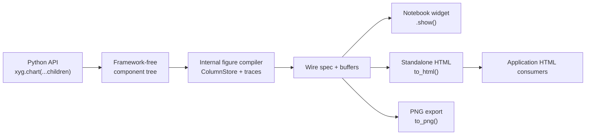

# Declarative composition API

**Status:** implemented core contract; framework adapter removed by #1063.
Core composition and styling remain supported independently of any web framework.

Goal: provide a declarative, children-first tree styleable with normal CSS
and Tailwind. The core package has **no web-framework dependency** and must keep
the notebook/static export ergonomics users already expect: `.show()`,
`widget()`, `to_html(...)`, and `to_png(...)`.

This proposal complements `chart-grammar.md`: that doc defines marks, panels,
and overlays; this one defines the public API shape and styling contract.

## 1. Summary

XYG should expose a small framework-agnostic component model:

```python
import xyg

chart = xyg.chart(
    xyg.scatter(
        x="feature_a",
        y="feature_b",
        color="segment",
        data=df,
        opacity=0.7,
    ),
    xyg.line(x=fit_x, y=fit_y, color="var(--brand-accent)", width=2),
    xyg.x_axis(label="feature A"),
    xyg.y_axis(label="feature B"),
    xyg.legend(),
    title="Customer clusters",
    width="100%",
    height=420,
    class_name="rounded border bg-white text-slate-950 dark:bg-zinc-950 dark:text-zinc-50",
    class_names={
        "legend": "text-xs rounded bg-white/80 shadow-sm dark:bg-zinc-900/80",
        "tooltip": "rounded-md bg-zinc-950 px-2 py-1 text-xs text-white shadow-lg",
        "modebar": "rounded border bg-white/80 backdrop-blur",
    },
    style={
        "--chart-grid": "rgba(148, 163, 184, 0.25)",
        "--chart-axis": "rgba(100, 116, 139, 0.85)",
        "--chart-text": "currentColor",
    },
)

chart.show()                 # notebook / IPython display
html = chart.to_html()       # standalone HTML
chart.to_html("chart.html")  # shareable file
chart._repr_html_()          # standalone HTML repr fallback
chart.to_png("chart.png")    # fast browser-free native PNG
chart.to_png("browser.png", engine=xyg.Engine.chromium)  # browser CSS/WebGL fidelity
```

The tree is a pure XYG Python object graph that
can be rendered by notebooks, static HTML export, and future adapters:



### Application hosts own application behavior

XYG is a renderer, not a second reactive framework. The application host owns:

- reactive expressions and computed state;
- conditional values and conditional styles;
- click, hover, selection, and other event handlers;
- component composition, responsive application layout, and lifecycle;
- application themes, design tokens, and reusable style systems.

XYG accepts the concrete values, CSS declarations, classes, data buffers, and
callbacks supplied by that integration. It emits render output and event
payloads. XYG must not add parallel `field()`, `condition()`, selection-state,
event-action, layout, or template DSLs; doing so would create two competing
sources of state and composition semantics.

## 2. Design Principles

- **No framework dependency in `xyg`.** The package may be easy to wrap
  in Streamlit or plain web apps, but it imports neither.
- **Frameworks stay application-owned.** Streamlit is dev/test-only; no framework
  namespace or dependency extra ships in XYG.
- **Declarative by default.** Component construction records intent. Rendering
  happens when the user calls `.show()`, `widget()`, `to_html(...)`,
  `to_png(...)`, or when an adapter mounts it.
- **One chart vocabulary.** Every mark factory (`xyg.scatter(...)`,
  `xyg.line(...)`, ...) resolves to the single mark implementation in
  `marks.py`, so mark names, channel names, defaults, and validation rules
  cannot fork.
- **CSS vocabulary styles chrome and marks.** DOM chrome receives the normal
  browser cascade. WebGL/native/SVG marks accept a smaller documented CSS
  appearance subset which XYG compiles to renderer values. Marks remain pixels,
  not selector-addressable DOM nodes.
- **Data never lives in framework state.** Component props describe bindings and
  styling. Large canonical arrays stay in XYG column storage and ship as
  binary buffers.
- **Notebook and static export stay first-class.** The declarative API is not
  only for web apps. It must render in Jupyter and export to standalone HTML.

## 3. Public API Shape

### 3.1 Component Nodes

Every public node is a plain Python object with `props` and `children`.

```python
xyg.chart(
    xyg.scatter(...),
    xyg.line(...),
    xyg.x_axis(...),
    xyg.y_axis(...),
    xyg.legend(...),
    title="...",
)
```

Target node types:

| Node | Purpose | Status |
|---|---|---|
| `chart(...)` | Single-panel container | Exists; existing `*_chart` wrappers remain |
| `figure(...)` | Multi-panel container | Later |
| `panel(...)` | Subplot/pane container | Later |
| `scatter(...)`, `line(...)`, etc. | Mark nodes | Exists for core marks |
| `x_axis(...)`, `y_axis(...)` | Scale chrome | Exists with scale, domain, side, label-position, format, and style hooks |
| `legend(...)` | Legend chrome | Exists |
| `tooltip(...)` | Tooltip chrome/customization | Exists |
| `modebar(...)` | Zoom/pan/reset controls | Exists |
| `colorbar(...)` | Continuous-scale chrome | Exists |
| `theme(...)` | CSS variable defaults | Exists |

The implementation can stay dataclass-like. It does not need React-style
lifecycle in Python; lifecycle belongs to render targets.

### 3.2 Props

Props use idiomatic Python naming:

- `snake_case`, not camelCase.
- `class_name`, not `className`.
- `data` plus string column references, similar to Recharts `dataKey` but more
  Pythonic: `x="date"`, `y="revenue"`, `color="segment"`.
- Event props start with `on_`: `on_hover`, `on_select`, later
  `on_view_change`.

```python
xyg.scatter(
    x="date",
    y="latency_ms",
    color="region",
    size="requests",
    data=df,
    name="requests",
    class_name="xy-mark-latency",
    style={"fill": "var(--accent)", "stroke-width": "1px"},
)
```

Important distinction: `class_name` on a mark is metadata for generated DOM
readouts and adapters. It cannot directly style already-rastered WebGL pixels.
Mark appearance uses the cross-renderer CSS subset:

```python
xyg.line(
    x="t",
    y="p95",
    data=df,
    style={"stroke": "var(--chart-critical)", "stroke-width": "2px"},
)
```

The older appearance keywords remain compatibility aliases. When both are
provided, `style` wins so an adapter has one predictable final override layer.

### 3.3 Readout Methods

Every renderable component exposes the full readout surface directly:

```python
chart.figure()       # advanced escape hatch: compile to the internal Figure
chart.widget()       # anywidget object
chart.show()         # display widget in notebook
chart.to_html()      # standalone string
chart.to_html(path)  # write standalone file
chart.html()         # alias for to_html()
chart._repr_html_()  # notebook/static HTML repr fallback
chart.to_png(path)   # native PNG by default; Engine.chromium is the browser tier
chart.memory_report()
```

`html()` is an alias only. `_repr_html_()` delegates to the standalone HTML
export path for notebook/export tools that inspect HTML representations instead
of anywidget display hooks. `to_html()` remains the canonical method because it
already exists and clearly communicates export behavior. `Chart.to_html(path)`
delegates to the engine's standalone export path, including same-directory
atomic file replacement for path writes.

`show(display=None)` resolves which notebook host renders the chart, and bare
rich display (`_ipython_display_`) on `Chart` and `Figure` follows the same
resolution with no argument. `"widget"` is the live anywidget host (Python callbacks, streaming
`append`, kernel-served LOD); `"html"` is the standalone-HTML host — the same
isolated `notebook_iframe` document as `_repr_html_()`, interactive in the
browser but with no kernel channel; on it `show()` returns an
`export.HtmlView` rich-repr handle instead of a widget. `None`/`"auto"`
consults the `XY_NOTEBOOK_DISPLAY` environment variable, then defaults by
runtime: an Emscripten/WASM kernel (JupyterLite, Pyodide) resolves to
`"html"`, everything else to `"widget"`. The WASM rule exists because the
widget host needs the anywidget *frontend* extension, which a prebuilt Lite
frontend cannot gain from a kernel-side `%pip install` — the comm opens
against a frontend that cannot answer it ("No version of module anywidget is
registered") and the kernel cannot observe that failure, so the fallback must
be decided kernel-side from the runtime. Two carve-outs keep the heuristic
honest: Marimo bundles its own anywidget frontend even in its WASM build, so
an Emscripten kernel with `marimo` imported stays on the widget host; and a
custom JupyterLite deployment that ships the anywidget extension can force
the widget host back via `XY_NOTEBOOK_DISPLAY=widget` or
`show(display="widget")`. Invalid values fail loud, naming the argument or
environment variable. `Figure.show`, `FacetChart.show`, and `FacetGrid.show`
follow the same resolution. `FacetChart`'s *bare* rich display is the one
deliberate exception: it always emits the composed standalone-grid document —
the only representation that preserves the grid layout (N stacked panel
widgets would not) — and that document is WASM-safe on every host. Live panel
widgets remain an explicit `widget()` / `show(display="widget")` choice.

## 4. Styling Contract

XYG should support styling through three layers, in this order:

1. **CSS variables** for theme tokens used by canvas and DOM chrome.
2. **Class hooks** for DOM chrome and wrapper styling.
3. **Mark props** for visual encodings that become pixels.

### 4.1 CSS Variables

The current `--chart-*` variables should remain supported. New names can alias
to the old ones later, but do not break existing docs or examples.

Recommended token surface:

| Token | Applies to |
|---|---|
| `--chart-bg` | Plot/background clear color |
| `--chart-grid` | Grid lines |
| `--chart-axis` | Axis lines and ticks |
| `--chart-text` | Axis labels, title, legend text |
| `--chart-tooltip-bg` | Tooltip background |
| `--chart-tooltip-text` | Tooltip text |
| `--chart-legend-bg` | Legend panel |
| `--chart-selection` | Box select fill/stroke |
| `--chart-modebar-bg` | Modebar and modebar-menu background |
| `--chart-modebar-active` | Modebar active/hovered button background |
| `--chart-modebar-focus` | Modebar keyboard focus ring (falls back to `--chart-focus`) |

`--chart-accent` is not an XYG token; the renderer never reads it. It is a
caller-defined convention variable that XYG only passes through when a mark
color is written as `var(--chart-accent)`.

Example:

```python
xyg.chart(
    xyg.line(x="date", y="revenue", data=df, color="var(--chart-accent)"),
    class_name="text-slate-900 dark:text-slate-50",
    style={
        "--chart-bg": "transparent",
        "--chart-grid": "rgba(148, 163, 184, 0.20)",
        "--chart-axis": "rgba(100, 116, 139, 0.80)",
        "--chart-accent": "rgb(37, 99, 235)",
    },
)
```

### 4.2 Class Hooks

The chart should accept:

```python
class_name: str | None
class_names: dict[str, str]
```

`class_name` applies to the root chart wrapper. `class_names` targets stable
DOM chrome slots:

| Slot | Element |
|---|---|
| `root` | Outermost `.xy` wrapper |
| `title` | Title chrome |
| `chrome` | Canvas-backed axis/grid/annotation layer |
| `canvas` | Plot canvas |
| `labels` | Axis/tick label layer |
| `annotation_layer` | Canvas-painted annotation layer as one bitmap |
| `legend` | Legend container |
| `legend_title` | Legend title |
| `legend_item` | Legend row |
| `legend_swatch` | Legend color swatch |
| `legend_label` | Legend text label |
| `colorbar` | Colorbar container |
| `colorbar_bar` | Colorbar gradient/bands |
| `colorbar_tick` | Colorbar tick label |
| `colorbar_title` | Colorbar title |
| `colorbar_extension` | One under/over-range extension |
| `colorbar_line` | One contour boundary on a line-only colorbar |
| `colorbar_minor_tick` | One unlabeled minor colorbar tick |
| `tooltip` | Tooltip container |
| `tooltip_title` | Tooltip title |
| `tooltip_row` | One tooltip row |
| `tooltip_label` | One tooltip field label |
| `tooltip_value` | One tooltip field value |
| `modebar` | Modebar container |
| `modebar_drag_handle` | Draggable modebar grip |
| `modebar_control_group` | Main control group |
| `modebar_separator` | Top-level toolbar separator |
| `modebar_button` | Modebar button |
| `modebar_icon` | Top-level button icon wrapper |
| `modebar_zoom_value` | Current zoom percentage |
| `modebar_indicator` | Zoom-limit or menu-open indicator |
| `modebar_selection_icon` | Active selection-mode icon |
| `modebar_menu` | Modebar popover |
| `modebar_menu_separator` | Popover separator |
| `modebar_menu_icon` | Popover command icon |
| `modebar_menu_label` | Popover command label |
| `modebar_history_controls` | Back/forward history group |
| `selection` | Selection rectangle, lasso path, and lasso handles |
| `crosshair_x` | Vertical crosshair line |
| `crosshair_y` | Horizontal crosshair line |
| `badge` | Reduction/density badge container |
| `badge_item` | Reduction/density badge row |
| `tick_label` | Axis tick label |
| `axis_title` | Axis title label |
| `annotation_label` | Text/label/callout annotation (DOM overlay) |
| `axis_band` | Invisible axis-only gesture band |
| `axis_line` | Cartesian axis baseline |
| `tick_mark` | Cartesian major or minor tick mark |

Each rendered slot also receives `data-xy-slot="<slot>"`, so plain CSS,
attribute selectors, and Tailwind arbitrary variants can target the same stable
surface even when the caller does not add a class. The client ships one
low-priority `base`-layer stylesheet whose selectors use
zero-specificity `:where([data-xy-slot="…"])`. Tailwind utilities in their
later layer, unlayered author CSS, and inline `chrome_styles` therefore win
over the built-in look without needing `!important`. In the standalone
`to_html(...)` export — which has no host page to inherit Tailwind from — pass
`custom_css="…"` to inject the stylesheet that defines those utility classes.
The canonical slot tuple is exported as `xyg.CHART_DOM_SLOTS` so adapters
and tests do not have to copy this table by hand. That root export resolves
through the lightweight DOM contract module, so framework adapters can inspect
the styling surface without importing NumPy, the chart engine, or widget stack.
`class_names` keys are validated against that tuple; unknown keys fail fast
instead of being silently ignored. The same validation is applied by the
internal `_figure.Figure` export path, so mutating `fig.class_names` or
`fig.chrome_styles` cannot bypass the public DOM-slot contract.

Tailwind example:

```python
xyg.chart(
    xyg.histogram(values="latency", data=df, bins=200),
    title="Latency distribution",
    class_name="h-[360px] w-full rounded-md border border-zinc-200 bg-white text-zinc-950 dark:border-zinc-800 dark:bg-zinc-950 dark:text-zinc-50",
    class_names={
        "legend": "rounded bg-white/80 text-xs shadow-sm dark:bg-zinc-900/80",
        "tooltip": "rounded-md bg-zinc-950 px-2 py-1 text-xs text-white shadow-xl",
        "modebar_button": "hover:bg-zinc-100 dark:hover:bg-zinc-800",
    },
)
```

### 4.3 Inline Styles

Support `style: dict[str, str | int | float]` on containers and chrome nodes.
This should serialize to safe DOM style assignment, not raw HTML.

Rules:

- Allow CSS custom properties.
- Avoid accepting raw CSS text strings.
- Avoid style props on WebGL-only mark internals unless they map to existing
  mark props.
- Preserve CSP compatibility for standalone export.

### 4.4 Tailwind Caveat

Tailwind can style the chart wrapper and DOM chrome. It cannot directly style
individual WebGL points/bars/lines after they are rasterized. For marks, use
props that resolve CSS colors:

```python
xyg.scatter(x="x", y="y", data=df, color="var(--chart-accent)")
```

This keeps Tailwind useful without pretending CSS can reach GPU buffers.

Application build systems own Tailwind class discovery. XYG exposes
`Figure.dom_class_strings()` for literal chart chrome classes, but does not
generate framework JSX or maintain a framework-specific scan manifest.
Hosts rebuilding constructor-owned chrome must dispose old views and preserve
only explicitly supported durable view state.

## 5. Tooltip Customization

Tooltips need a first-class declarative surface because they are where application
users expect customization.

Target API:

```python
xyg.chart(
    xyg.scatter(x="x", y="y", color="segment", data=df),
    xyg.tooltip(
        fields=["x", "y", "segment"],
        title="{segment}",
        format={
            "x": ".2f",
            "y": ".2f",
        },
        class_name="rounded bg-zinc-950 text-white shadow-lg",
    ),
)
```

Design rules:

- Tooltip content is data, not raw HTML.
- `fields`, `title`, and `format` compile to a safe client readout spec.
- Text is inserted with `textContent` or text nodes.
- Framework adapters can map tooltip payloads to framework-side custom
  components. Core `xy` stores those components as opaque Python
  objects and does not import a web framework.

Implemented adapter hook:

```python
chart = xyg.chart(
    xyg.scatter(x="x", y="y", color="segment", data=df),
    xyg.legend(rx.vstack(...), show=False),
    xyg.tooltip(rx.box(...), show=False, fields=["x", "y", "segment"]),
    xyg.colorbar(rx.vstack(...), show=False),
)

chart.chrome_components()
# {"legend": <rx.vstack ...>, "tooltip": <rx.box ...>, "colorbar": <rx.vstack ...>}
```

The render objects are not serialized into standalone HTML. `show=False`
suppresses the built-in DOM chrome when an adapter is replacing it; leaving
`show=True` keeps the normal safe built-in fallback.

Potential future advanced API:

```python
xyg.tooltip(render="compact_metric")  # named client-side template
```

Avoid accepting arbitrary JS callbacks in standalone HTML. Notebook callbacks
can stay on `on_hover`, where Python is present.

## 6. Event Model

Events should be semantic, small, and transport-independent.

```python
def hover(row: dict): ...
def selected(selection: xyg.Selection): ...
def view_changed(view: dict): ...

xyg.chart(
    xyg.scatter(x="x", y="y", data=df),
    on_hover=hover,
    on_select=selected,
    on_view_change=view_changed,
)
```

Event payloads:

| Event | Payload |
|---|---|
| `on_hover` | One row/readout dict |
| `on_select` | An `xyg.Selection`: `.per_trace` (trace id to index array), `.index` (concatenated indices), `len()`, and `.xy(trace_id)` for the selected `(x, y)` arrays |
| `on_view_change` | `{ranges, source, axes, phase, interaction_id}` — the per-axis view (`ranges` map) plus the gesture label, the axes that changed, the phase, and the gesture id, with `x0`/`x1`/`y0`/`y1` aliases for the primary axes (`channel.py:217-258`). No pixel shape. |

Render target behavior:

- Notebook widget: callbacks can call Python.
- Standalone HTML: no Python callback and no serialized callable/framework
  object. Event props compile only to interaction flags such as
  `{"hover": true, "select": true}`. Optionally dispatch DOM `CustomEvent`s for
  host pages.
- Application HTML consumers: browser DOM events; Python callbacks require an
  explicit live transport, which the stock Streamlit example does not provide.

## 7. Render Targets

The component tree compiles once and can target multiple renderers.

| Target | Method | Notes |
|---|---|---|
| Notebook widget | `show()` / `widget()` | Python callbacks available; the `show()` default except on WASM kernels (§3.3) |
| Notebook/static HTML repr | `_repr_html_()` / `show(display="html")` | Self-contained fallback that reuses standalone export; auto-selected by `show()` on WASM kernels (JupyterLite/Pyodide), whose prebuilt frontends cannot load the anywidget extension |
| Standalone HTML | `to_html()` / optional `html()` alias | Self-contained, no Python callbacks |
| Static PNG | `to_png()` | Fast native default; optional Chromium standalone screenshot |
| Streamlit example | stock HTML embedding | Repository consumer; no Python callback bridge |
| Future server app | generic payload/message routes | Same wire protocol |

This keeps the API framework-shaped without making XYG a framework
package.

## 8. Application consumers

See [application-consumers.md](application-consumers.md). No Reflex adapter,
namespace, extra or compatibility shim ships. Stock Streamlit HTML is a snapshot
without Python callbacks; Node/browser hosts attach the shared client directly.

## 9. Concrete Code Examples

These examples are written as target API sketches. They show the intended shape
of the API before implementation details are locked.

### 9.1 Notebook-First Chart That Also Exports

This is the core promise: the declarative API feels component-shaped, but it
still works like today's notebook-friendly XYG objects.

```python
import numpy as np
import pandas as pd
import xyg

rng = np.random.default_rng(7)
df = pd.DataFrame(
    {
        "x": rng.normal(size=50_000),
        "y": rng.normal(size=50_000),
        "segment": rng.choice(["enterprise", "growth", "self serve"], size=50_000),
    }
)

chart = xyg.chart(
    xyg.scatter(
        x="x",
        y="y",
        color="segment",
        data=df,
        opacity=0.55,
        name="accounts",
    ),
    xyg.x_axis(label="activation score"),
    xyg.y_axis(label="retention score"),
    xyg.legend(),
    title="Account clusters",
    width="100%",
    height=420,
)

chart.show()                       # notebook / IPython
chart.to_html("clusters.html")     # standalone shareable file
chart.to_png("clusters.png")       # fast browser-free native PNG
```

The same object compiles to the internal `_figure.Figure`, so engine
internals and future adapters share the same payload path:

```python
fig = chart.figure()
report = chart.memory_report()
```

### 9.2 Tailwind-Styled Operations Chart

This example shows the styling contract: Tailwind classes style the wrapper and
DOM chrome, while marks use props and CSS variables that the renderer resolves.

```python
import xyg

chart = xyg.chart(
    xyg.histogram(
        values="latency_ms",
        data=requests,
        bins=240,
        density=True,
        color="var(--chart-accent)",
        name="latency",
    ),
    xyg.rule(y=0.95, color="var(--chart-critical)", dash=True),
    xyg.tooltip(
        fields=["latency_ms", "count"],
        title="Latency",
        format={"latency_ms": ".1f", "count": ",.0f"},
        class_name="rounded-md bg-zinc-950 px-2 py-1 text-xs text-white shadow-xl",
    ),
    title="API latency distribution",
    width="100%",
    height=360,
    class_name=(
        "h-[360px] w-full rounded-md border border-zinc-200 bg-white "
        "text-zinc-950 dark:border-zinc-800 dark:bg-zinc-950 dark:text-zinc-50"
    ),
    class_names={
        "legend": "rounded bg-white/80 text-xs shadow-sm dark:bg-zinc-900/80",
        "modebar": "rounded border bg-white/80 backdrop-blur dark:bg-zinc-900/80",
        "modebar_button": "hover:bg-zinc-100 dark:hover:bg-zinc-800",
    },
    style={
        "--chart-bg": "transparent",
        "--chart-grid": "rgba(148, 163, 184, 0.20)",
        "--chart-axis": "rgba(100, 116, 139, 0.80)",
        "--chart-accent": "rgb(37, 99, 235)",
        "--chart-critical": "rgb(239, 68, 68)",
    },
)
```

Tailwind controls layout and chrome. The histogram pixels still come from the
compiled mark spec, which is what keeps large-data rendering fast and
framework-independent.

### 9.3 Application examples

Use `examples/streamlit/app.py` and `examples/vanilla-ts/`. They are repository
consumers of the existing APIs, not shipped integration packages.

## 10. Compatibility Contract

Must keep:

- The composition API as the single public chart-building surface (the
  internal `_figure.Figure` fluent API is no longer public).
- Existing `scatter_chart`, `line_chart`, etc. wrappers.
- `Chart.figure()`.
- `Chart.widget()`.
- `Chart.show()`.
- `Chart.to_html(...)`.
- `Chart.to_png(...)`.
- Static HTML exports with no Python/Reflex runtime.
- No web-framework import in `xyg`.

Now part of the core alpha contract:

- Neutral `xyg.chart(...)`.
- `xyg.tooltip(...)`, `xyg.modebar(...)`, `xyg.theme(...)`.
- `xyg.colorbar(...)` with inferred built-in continuous-scale chrome, the same
  CSS slots, and an opaque adapter-render replacement contract.
- `class_name`, `class_names`, and `style` props.
- DOM `CustomEvent`s for standalone host integration (see Phase 4 for the
  dispatched set).

Framework support follows [application-consumers.md](application-consumers.md);
there is no bundled framework adapter.

Should avoid:

- Raw HTML tooltip strings.
- Raw JS callbacks in Python specs.
- Per-mark imperative draw functions.
- Storing large arrays in framework state.
- Making Tailwind classes pretend to style WebGL pixels.
- Pulling application frameworks into XYG runtime dependencies.

## 11. Implementation Plan

### Phase 1: Styling Props On Existing Components

- Add `class_name`, `class_names`, and `style` to `Chart`.
- Add class hooks to DOM chrome in `ChartView`.
- Preserve current inline styles as defaults, but let classes and CSS variables
  override where safe.
- Implemented: `CHART_DOM_SLOTS` exports the fixed slot list, client tests
  verify every slot is applied, and user text still uses text nodes.

### Phase 2: Neutral Container And Tooltip Node

- Add `xyg.chart(...)` as a kind-neutral alias.
- Add `xyg.tooltip(...)` node compiling to safe tooltip readout spec.
- Keep existing `*_chart(...)` helpers as ergonomic aliases.

### Phase 3: CSS Variable Expansion

- Document and test the full CSS variable table.
- Cache CSS color resolution outside hot render paths.
- Add examples for vanilla CSS and Tailwind.

### Phase 4: Events And Standalone Host Hooks

- Add `on_view_change`.
- For standalone HTML, dispatch DOM `CustomEvent`s. Shipped: `xy:hover`,
  `xy:select`, `xy:view_change`, `xy:click`, `xy:brush`, `xy:leave`,
  `xy:context_lost`, `xy:context_restored`, `xy:context_restore_failed`.
  All are emitted through one template as `xy:${name}`, bubbling and composed.
- Keep Python callbacks notebook-only.

### Phase 5: Application consumers

Repository Streamlit/Python and Node/vanilla TypeScript examples exercise the
public APIs without a shipped framework adapter.

## 12. Acceptance Criteria

- A user can build a line-on-scatter overlay declaratively.
- The same chart can call `.show()` in a notebook and `to_html()` for static
  export.
- The chart root and chrome can be styled with Tailwind classes.
- Mark colors can be driven by CSS variables.
- `pip install xyg` does not install Reflex.
- Artifacts contain no framework adapter namespace or Reflex extra.
- Security tests still prove text is never inserted via HTML parser sinks.
- Large data remains binary/screen-bounded; no chart data enters framework
  state by default.
