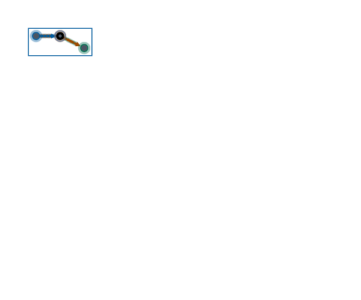

# Retained temporal Worker and shared Scene export continuation

Continuation of `8d32c3dc5be0e6356c9bf88b3eac964a74a842df`, preserving
`59b1c38a337925a8bad11333ed8d04aea76a03e0` acquisition ancestry, the complete
ABI399/401/402/403 fixture history and all prior producer receipts. No remote,
other producer, issue, milestone, PR, publication or paid job was changed.

ABI404/WASM36 now acquire the actual private successful Worker frame and
accepted session publication, capture the last successfully painted computed CSS focus as raw f32, preserve
accepted controller window/revision separately from later interactions, and
produce canonical Scene/XYPB/SVG/HTML through shared Rust policy. Offline HTML
embeds the exact Scene, painter, XYFG and shipped client and uses the same
ChartView painter. Native Python/Node also render PNG through the existing
Rust raster/PNG implementation. Recovery validates and regenerates the complete
artifact, including the expected shipped HTML client. There is no authenticity
or signature claim, second chart builder, layout, reroute or host style policy.

Seven real Worker cases cover six glyphs and a focused compound parent, selected
and pinned leaf state, nonzero trim/dash phase, different status/epistemic layers,
DPR2, scales1/2, later scrub and complete producer/controller disposal. They
compare native/WASM Scene/XYPB/SVG/HTML bytes, exact imported XYFG recovery,
backing dimensions and actual offline ChartView pixels. Independent vectors
check exact retained heads, all shaft layers and phase intervals, literal IDs,
CSS centers, frame strips and mathematical focus bands. Native regressions
also cover DPR1/2, node/edge focus, scales1/2, malformed carriers/v2 values,
capacity sentinels and immutable lifetime. The normal pytest test, explicit
Node test list and full source-dist foundation include these paths.

The new pixel oracle found the generic stroked marker radius convention was
unsuitable for retained inset strokes. Retained strokes/focus now lower as
bounded disjoint shared-SDF bands, with fill-only circle/square interiors and
halos. The exact-head oracle found identity scale divide/multiply rounding;
identity scales now retain f64 bits, including signed zero. The ordinary Scene
and static cross-host suite passes without updating product golden packets.

## Unchanged single-module caps and explicit PNG gap

| Same source/profile or bounded probe | Raw bytes | gzip6 bytes | Disposition |
|---|---:|---:|---|
| O3 / inline50 | 1,963,554 | 802,070 | rejected, both caps |
| O2 / inline50 paired source | 1,904,840 | 784,800 | selected profile |
| Qualified O2 / inline50 (test-module relocation only) | 1,904,840 | 784,799 | normal packaging passes |
| Size / inline50 | 1,854,348 | 767,360 | rejected runtime tradeoff |
| Restricted raster commands, global raster feature / O2 | 2,505,577 | 1,020,398 | diagnostic, both caps fail |
| Minimal frozen-only raster feature and shared renderer / O2 | 2,174,875 | 898,699 | diagnostic, both caps fail |

Caps remain **1,927,168 raw / 786,432 gzip6**. O2 leaves 22,328 raw and 1,632
gzip bytes on the paired source; the qualified module leaves1,633. Native stays O3; fat LTO/codegen1/strip, dependencies, all existing
shipped exports/capabilities/guards, Binaryen132 `-O3 --all-features`, runtime
arenas and deadlines remain unchanged. Same-source O2/O3 ABBA outputs are
identical on admitted GraphForge/geographic workloads at100/10k/100k; measured
runtime ratios span0.977–1.103. This is a local size/runtime tradeoff, not a
speed victory. The size profile's catalog ratio near1.96 is recorded and that
profile is not selected. Cold-start samples and every raw sample remain in
`profile-*.json`. The benchmark's historical `gzipBytes` field uses gzip9;
**packaging qualification and the table above use gzip6**.

The final minimal probe excludes unrelated native formats and native geographic
raster reachability, and specializes existing Scene/raster command branches.
It is one diagnostic module, never a separately budgeted or shipped module.
Its 14 actual PNG outputs are byte-identical to native for the seven retained
cases at scales1/2. It still exceeds raw/gzip caps by247,707/112,267 bytes.
Compared with the selected module it adds176,409 code-section bytes and93,194
data-section bytes; exact sections/function-body sizes are in
`code-size-attribution.json`. There is no additive gzip attribution claim.
The complete reproducible probe patch and source manifests are retained.
**Diagnostic PNG correctness is not packaging qualification.**

The shipping module therefore returns `XYG_WASM_RESOURCE_LIMIT` with
`XYG_FROZEN_PNG_UNAVAILABLE` and empty output. Later supported exports remain
usable. Full native/WASM rendered PNG acceptance remains **OPEN**, as do full
#45 scale/aggregate/accessibility and milestone acceptance. There is no scope
waiver, optional module, cap/deadline/tolerance increase or whole-#45 claim.
RGBA8 Scene rendering preserves the captured f32 focus separately in XYFGv2;
the versioned contract states this color quantization explicitly.

## Reproduction and bindings

Use Node22.23.4, Rust1.96.0 and Chromium1248 as recorded in `checks.json`.
Native and producer artifacts live in this task's owned directories; no shared
`/home/ubuntu/.t3tmp/1111/target` artifact is reused. `rust-source-inputs.json`
seals all Rust inputs. `checks.json` binds exact source, native/WASM/client,
raw capture, artifact, environment and log bytes. Compressed artifacts recover
byte-for-byte with gzip; screenshots and XYFG are retained directly. The prior
8d native library remains pinned at its original digest for historical receipts.
Existing acquisition and earlier native-only tests/reviews are inherited,
not described as fresh final-WASM proof. Intermediate failures and failed
size attempts are preserved and labelled; the failed minimal-feature build's
stale copied module is explicitly excluded from qualified artifact bindings.

```bash
export PATH=/home/ubuntu/.t3/worktrees/xyg/t3-1b0dd836/target/task-tmp/node-v22.23.4-linux-x64/bin:/home/ubuntu/.cargo/bin:/home/ubuntu/.local/bin:$PATH
export TMPDIR=/home/ubuntu/.t3-owned/1cafa70d
export CARGO_TARGET_DIR=$TMPDIR/target
export PYTHONPATH=python
cargo build -p xyg-core --release
export XYG_NATIVE_LIB=$CARGO_TARGET_DIR/release/libxyg_core.so
export XYG_CHROMIUM=/home/ubuntu/.cache/ms-playwright/chromium-1248/chrome-linux64/chrome
export XYG_FROZEN_CHROMIUM=$XYG_CHROMIUM
node js/build.mjs
cargo build -p xyg-wasm --release --target wasm32-unknown-unknown
node js/package-wasm.mjs "$CARGO_TARGET_DIR/wasm32-unknown-unknown/release/xyg_wasm.wasm"
uv run pytest tests/test_temporal_graph_frozen.py -q
node --test packages/xy-node/test/temporal-graph-frozen-wasm.test.mjs
node scripts/wasm_foundation_smoke.mjs
```

The `probe-minimal-feature.patch` is a rejected size probe against the measured
source in `probe-source.tar.gz`. The final source only relocates the cfg(test)
module afterward for Clippy; both source manifests are retained. To reproduce, export this commit into a private directory, apply that
patch, build with `--features xyg-engine/frozen-raster` and the same O2/inline50
flags, then run the pinned optimizer. It must not replace shipping assets or
be accepted merely because its PNG output matches native. `probe-commands.txt`
records the actual separate source/target paths and commands.

## Visual and comparison scope

The captured offline glyph/frame images in `artifacts/` are actual ChartView
renders, not illustrations. The generated capability matrix and versioned
frozen contract describe the bounded surface. No new timing, memory, payload,
startup or massive-data victory over Matplotlib, Seaborn, Plotly, Bokeh, Altair,
Datashader, HoloViews/hvPlot or emerging alternatives is claimed. This receipt
qualifies correctness of this retained export slice; comparative performance
and full issue acceptance remain separate work.

Actual captured examples (offline ChartView, source graph fixed at CSS240×180):




The actual Worker matrix uses explicit384 MiB instances. Default16 MiB
instances retain their existing ceiling and may refuse rich SDF/HTML exports.
HTML recovery requires the exact expected producing client (native defaults to
the installed bundle); cross-version HTML recovery is not qualified. Historical
8d artifacts and its pinned ABI403 producer remain immutable; this receipt
does not relabel older renderer bytes as newly produced artifacts.

Gate compression uses Node22's `gzipSync` default level6 (zlib1.3.1-e00f703).
The archival Python gzip6 stream can be smaller and is never substituted for
the gate measurement; `gzip-measurement.json` records the distinction. The
qualified module's final one-byte gzip change follows only the test-module
relocation; the paired-source runtime measurements retain their own hashes.

The final CI wiring check passed666 existing workflow mutation tests and the
new explicit-native regression separately. The first new regression used a
global source-count assumption and failed because another job has the same
binding; it now mutates the exact foundation step and proves refusal. The
discovered Worker journey also passed with the parent native environment unset:
Python names the verified loaded core for Node. These raw attempts remain in
the receipt. No gate, timeout, test assertion, or merge-group trigger was removed.
